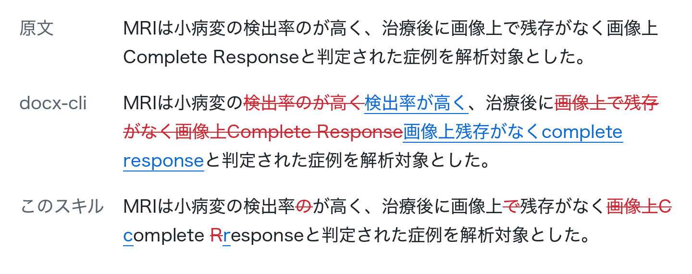

# docx-redline-ja

English version:  [README_en.md](README_en.md)

Word文書（.docx）に、日本語文章の校正結果を変更履歴として書き込むスキルです。

英語のような単語の境界に空白を用いる言語を想定した処理では、差分が一見して分かりにくいため、どこが修正されたのかが分かりにくいです。

このスキルは差分を文字単位で取るので、変更履歴に残るのは実際に変わった文字だけになります。このため、修正前後の変更箇所を見比べる必要性が下がり、文章校正の確認、承認作業が効率化されます。

### 適用例

<picture>
  <source media="(prefers-color-scheme: dark)" srcset="docs/example-ja-dark.png">
  
</picture>
同じ2件のfindingsを、docx-cli 0.28.0（`replace --batch`）とこのスキルで入れた結果です。
docx-cliは一致した句をまるごと削除して書き直しますが、このスキルは変わった文字だけを変更履歴に残します。

```jsonl
{"old_text":"検出率のが高く","new_text":"検出率が高く"}
{"old_text":"画像上で残存がなく画像上Complete Response","new_text":"画像上残存がなくcomplete response"}
```

## 目次

- [できること](#できること)
- [できないこと](#できないこと)
- [ベンチマーク](#ベンチマーク)
- [導入](#導入)
- [使い方](#使い方)
  - [findingsを書く](#findingsを書く)
  - [適用する](#適用する)
  - [結果を読む](#結果を読む)
  - [位置を調べる](#位置を調べる)
- [開発者向け](#開発者向け)
- [ライセンス](#ライセンス)

## できること

- findingsの`old_text`/`new_text`の組を、原稿docxの別コピーにWordの変更履歴（`w:ins`/`w:del`）として書き込みます。原稿とfindingsは書き換えません。
- 差分を文字単位で最小化します。
- 変更履歴の著者名と日時を指定できます。日時を固定すれば、同じ入力から同じバイト列の出力が得られます。
- 上付き・下付きを`<sup>`/`<sub>`/`<plain>`で指定できます。文献番号や単位（mm<sup>3</sup>など）の修正に使います。
- 用語の統一のように一致した全箇所を直す指摘（`replace_all`）と、本文と文献一覧で方針が違う指摘（`scope`で段落範囲を限る）を扱えます。
- 原稿に他人の変更履歴が入っていても、それを壊さず重ねて書きます。
- 出力を書く前に、変更履歴をすべて却下すると原稿に戻ること（`reversible`）、他人の変更履歴が変わっていないこと（`other_revisions_preserved`）など5項目を検証し、1つでも落ちればdocxを書きません。
- 原稿を書き換えずに、語の位置を調べる`locate`と、段落の本文を読む`read`が付いています。
- 依存はPython 3.11以降と`lxml`だけで、スキルのディレクトリをどこに置いても動きます。

## できないこと

- 校正そのものはしません。何をどう直すかを決めるのは、Claude Codeなどのエージェントか人の仕事で、このスキルはその結果をdocxに反映するだけです。
- 編集するのは本文（`word/document.xml`）の段落だけで、表のセルとテキストボックスの中は含みます。コメント、ヘッダー・フッター、脚注は対象外です。
- `old_text`は1段落内に収まるものだけを扱います。段落をまたぐ修正や、段落の結合や分割はできません。
- 書式のうち扱うのは上付き・下付きだけで、太字やフォントの変更は書けません。
- 一致範囲がタブ、画像、フィールド、脚注番号などに掛かる修正は適用しません（`spans_inline_object`としてskipします）。
- 指摘どうしの編集範囲が重なると、どちらも適用せずに`conflict`として返します。どちらかを優先することはしません。

## ベンチマーク

Claude Codeに原稿と20件の修正指示を渡し、変更履歴を入れたdocxを作らせて、使ったトークンと費用を比べました。
モデルはSonnet 5.5（`claude-sonnet-5-5`）、文書は40段落で、値は3回の平均です。
4つの欄は、それぞれ1つの道具だけを使える状態で同じ仕事をしています。

| 言語 | 使った道具 | 費用（USD） | 入力トークン | 出力トークン | 変更履歴の文字数（最小の何倍か） |
| --- | --- | ---: | ---: | ---: | ---: |
| 日本語 | このスキル | 0.060 | 51,933 | 644 | 1.0倍 |
| 日本語 | なし（モデル単独） | 0.068 | 70,370 | 1,653 | 1.0倍 |
| 日本語 | `docx`スキル | 0.079 | 74,055 | 1,589 | 1.0倍 |
| 日本語 | docx-cli | 0.080 | 92,508 | 1,028 | 28.1倍 |
| 英語 | このスキル | 0.060 | 56,726 | 764 | 1.0倍 |
| 英語 | なし（モデル単独） | 0.096 | 86,113 | 2,295 | 1.1倍 |
| 英語 | `docx`スキル | 0.075 | 71,110 | 1,678 | 1.1倍 |
| 英語 | docx-cli | 0.065 | 70,186 | 709 | 10.2倍 |

このスキルは、日英とも費用、入力トークン、出力トークンのすべてが4つの中で最も少なくなりました。
モデル単独と比べると、費用は日本語で12%、英語で37%少なく、入力トークンは26%と34%、出力トークンは61%と67%少なくなっています。
モデルが書くのは1件1行のJSONLだけで、docxのXMLを読み書きしないためです。

変更履歴の小ささでは、Sonnet 5.5は単独でも日本語で最小にできました。
単語単位で差分を取るdocx-cliとの差（日本語で28倍）は残ります。
方法と再現の手順は[開発者向けのベンチマーク](#ベンチマークの回し方)にあります。

## 導入

### Claude Code

このリポジトリはClaude Codeのマーケットプレイスの形になっています（`.claude-plugin/marketplace.json`）。
マーケットプレイス名とプラグイン名はどちらも`docx-redline-ja`です。

```
/plugin marketplace add akchan/docx-redline-ja
/plugin install docx-redline-ja@docx-redline-ja
```

インストールせずに試すなら、cloneしたディレクトリを`--plugin-dir`で渡します。

```bash
claude --plugin-dir /path/to/docx-redline-ja/plugins/docx-redline-ja
```

### Codex

Codex CLIは、このリポジトリをそのままマーケットプレイスとして読み込めます。

```sh
codex plugin marketplace add akchan/docx-redline-ja
codex plugin add docx-redline-ja@docx-redline-ja
```

入れたあとは、Codexの中で`/skills`を開くか、`$docx-redline-ja`と書いてスキルを呼び出せます。
プラグインを使わずにスキルだけを置く場合は、`plugins/docx-redline-ja/skills/docx-redline-ja/`を`~/.agents/skills/`の下にコピーします。

### Claude Desktop（Cowork）

1. サイドバーの「Customize」から「Plugins」を開きます。
2. 「Add marketplace」を選び、`akchan/docx-redline-ja`を入力します。
3. 一覧に出てくるdocx-redline-jaを「Install」します。

入れたプラグインはアカウントに保存されるので、Coworkのほか、通常のチャットとClaude Codeでも使えます。

### そのほかのエージェント

スキルの実体は`plugins/docx-redline-ja/skills/docx-redline-ja/`の1ディレクトリで、`SKILL.md`、`references/`、`scripts/`からなります。
`SKILL.md`形式のスキルを読めるエージェントなら、このディレクトリをそのスキル置き場にコピーすれば使えます。
絶対パスや環境変数への依存が無いことはテスト（`tests/test_decoupling.py`）で確かめています。

Pythonから直接使うこともできます。

```bash
pip install -r requirements.txt   # lxml>=5.0
```

## 使い方

Claude Codeからは、原稿docxとfindingsを渡して「変更履歴として反映して」と頼めばスキルが呼ばれます。
以下は、スキルの中で何が起きているかと、手で実行するときの手順です。
`<skill_dir>`は`SKILL.md`があるディレクトリを指します。

### findingsを書く

UTF-8のJSON Linesで、1行に1件の指摘を書きます。
空行と`#`で始まる行は無視します。

```jsonl
{"old_text":"所見がみられか？","new_text":"所見がみられるか？"}
{"old_text":"FDG-PET/CTでは","new_text":"<sup>18</sup>F-FDG-PET/CTでは"}
{"old_text":"MRI検査","new_text":"MRI 検査","replace_all":true}
{"old_text":"不要な語句","new_text":""}
{"old_text":"、","new_text":"，","replace_all":true,"scope":"p0-119"}
```

- `old_text`：必須。原稿の変更履歴をすべて承諾した状態の本文と照合します。1段落内に収まり、（`scope`の範囲内で）一意である必要があります。
- `new_text`：必須。置換後の文字列です。空文字列なら削除になります。`<sup>`、`<sub>`、`<plain>`だけをタグとして解釈し、タグの無い文字は原稿の上付き・下付きを引き継ぎます。
- `replace_all`：`true`なら一致した全箇所に適用します。既定は`false`です。
- `scope`：照合する段落の範囲です。`"p12"`、`"p10-12"`、`"p3,p10-12"`、`"p120-"`のように書きます。段落番号は0始まりです。

これ以外のキー（`id`、`severity`など）があってもレコードは有効で、解釈されないまま結果に名前だけが出ます。
キー名の打ち間違いはここで分かります。
細則は[findings_schema.md](plugins/docx-redline-ja/skills/docx-redline-ja/references/findings_schema.md)にあります。

### 適用する

```bash
python3 <skill_dir>/scripts/apply_redline.py \
  --docx 原稿.docx --findings findings.jsonl --out 校正済み.docx --author "Claude Opus 5.5"
```

- `--author`：変更履歴の著者名です。Wordの校閲ペインに出ます。スキルから呼ぶときは、エージェントが自分のモデル名を渡します。省略すると`AI`になります。
- `--date`：変更履歴の日時（ISO 8601）です。省略すると現在時刻（UTC）になります。固定すると出力が再現可能になります。

`--out`は`.docx`で終わる必要があり、`--docx`、`--findings`、`--out`、レポートのうち2つが同じファイルを指すと何も書かずに終わります。
macOSのように大小文字を区別しないファイルシステムでの`a.docx`と`A.docx`も同じファイルとみなします。

終了コードは3つで、`0`は検証が通ってdocxを書いた、`1`は検証が落ちてdocxを書かなかった、`2`は入力の不備で起動時に止まった、を表します。
skipされたレコードがあっても、検証が通れば`0`で終わります。
何が落ちたかは次のレポートで見ます。

### 結果を読む

レポートは`--out`の拡張子を`.result.json`に変えたパスに書かれ、stdoutにはその要約が出ます。
要約には件数、検証結果、注記と、skipされたレコードだけが含まれます。

```jsonc
{"out": "…", "result": "…/校正済み.result.json",
 "counts": {"records": 22, "applied": 13, "skipped": 9, "hunks": 19, "by_reason": {"ambiguous": 1, "conflict": 2}},
 "verification": {"reversible": true, "insertions_independent": true,
   "other_revisions_preserved": true, "revisions_wellformed": true, "media_preserved": true},
 "notes": ["…"],
 "records": [/* skipしたレコードだけ。reason / detail / occurrences */]}
```

skip理由は8つ（`invalid_record`、`crosses_paragraph`、`no_change`、`not_found`、`ambiguous`、`spans_inline_object`、`conflict`、`unsplittable_container`）で、各レコードの`detail`に説明が付きます。
よく出るのは次の3つです。

- `ambiguous`：2箇所以上に一致したときです。`occurrences`に前後の文脈が付くので、`old_text`を伸ばすか、`scope`で段落を絞るか、全箇所を同じに直す指摘なら`replace_all`を付けます。
- `conflict`：他のレコードと編集範囲が重なったときです。重なる指摘を1レコードにまとめます。
- `not_found`：一致が無いときです。全角・半角、約物、空白の違いを疑ってください。

### 位置を調べる

`locate`と`read`は原稿を読むだけで、書き換えません。
段落番号は`scope`、`locate`、`read`、レポートのすべてで共通です。

```bash
python3 <skill_dir>/scripts/apply_redline.py locate --docx 原稿.docx --query "FDG-PET" --no-matches
python3 <skill_dir>/scripts/apply_redline.py read --docx 原稿.docx --paragraphs "p10-20" --text
```

`locate`は一致の数、一致した段落の一覧、そのまま`scope`に書ける文字列を返します。
`--no-matches`を外すと各一致の前後の文脈も出ます。
`read`は段落ごとの本文を返し、上付き・下付きを含む段落には`<sup>`/`<sub>`付きの本文も付きます。
`--paragraphs`を付けずに`read`を呼ぶと原稿が丸ごと出るので、エージェントに読ませるときは範囲を絞ってください。

変更履歴の組み方（既存の変更履歴の中に挿入するときの分割など）と検証項目の定義は[ooxml_tracked_changes.md](plugins/docx-redline-ja/skills/docx-redline-ja/references/ooxml_tracked_changes.md)にあります。

## 開発者向け

### テスト

```bash
pip install -r requirements-dev.txt
python3 -m pytest -q
```

テストに使うdocxの多くは実行時に生成します。Wordで作った4つの文書だけは`tests/fixtures/`に置いてあり、作成者や日時などのメタデータは消してあります。
日本語の本文は夏目漱石『吾輩は猫である』（青空文庫）、英語はLewis Carroll『Alice's Adventures in Wonderland』（Project Gutenberg）から取っています。
出典と扱いは[TEST_DATA.md](TEST_DATA.md)にあります。
CIはGitHub ActionsでUbuntuとmacOS、Python 3.11〜3.13の組み合わせで回します。

`tests/test_behavior_pins.py`は、上付き・下付き、表のセル、テキストボックス、他人の変更履歴、全skip理由を踏む文書を組んで、レポートと出力XMLをスナップショットと比べます。
意図して挙動を変えたときは`python3 tests/test_behavior_pins.py --regen`で更新し、差分を見ます。

### ベンチマークの回し方

`benchmarks/`に、同じ修正を他のツールで入れたときとの比較があります。
比較対象はdocx-cli（npmの`bun-docx`）と、Anthropicが配布している`docx`スキル（OOXMLを手で書く）です。
採点は`benchmarks/measure.py`が出力docxを直接読んで行い、どのツールの検証コードも使いません。

- `run_deterministic.py`：モデルを使わず、決まった修正を各ツールに入れて、変更履歴が正しいか（承諾すると意図した本文、却下すると原文に戻る）と、変更履歴の中の文字数が最小の何倍か、を測ります。
- `run_agentic.py`：Claude Codeに原稿と修正指示を渡して、ツールの操作まで含めた一仕事をさせ、トークン数と費用を測ります。各回は`--restricted`で1つの道具だけを見せ、sandboxの中で動かします。入力トークンはキャッシュの読み書きを含み、費用はClaude Codeが報告する額です。APIを呼ぶので費用がかかり、CIでは回しません。

`benchmarks/out/deterministic.md`の結果では、日本語20件の修正で変更履歴に入る文字数は、このスキルが45文字（最小と同じ）、docx-cliが1265文字（28.1倍）でした。
英語では140文字に対して1430文字（10.2倍）で、差は日本語のほうが大きくなります。
[ベンチマーク](#ベンチマーク)の表は次のコマンドで取りました。

```bash
python3 benchmarks/run_agentic.py --model claude-sonnet-5-5 --lang both --runs 3 --tasks 20 --paragraphs 40 --max-turns 80
```

`benchmarks/out/`は`.gitignore`に入っていて、数字を更新するときは手元で回します。

### READMEの図

冒頭の比較図は`python3 tools/render_readme_example.py`で描き直します。
例文から1段落のdocxを組み、同じfindingsをこのスキルとdocx-cli（`bunx bun-docx@0.28.0`）に入れ、出力docxの`w:del`/`w:ins`を読んで描くので、手で描いた部分はありません。
Pillowと`bunx`と日本語フォントが必要です。

## ライセンス

MITです。[LICENSE](LICENSE)を見てください。
