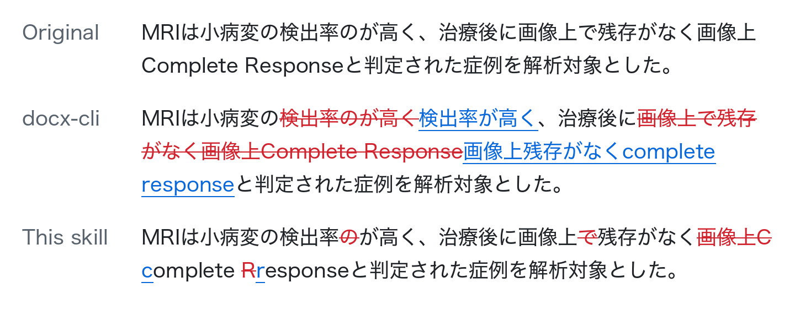

# docx-redline-ja

[日本語](README.md)

Write AI proofreading results into a Word manuscript as tracked changes. Even in
Japanese, the tracked change covers only the characters that actually changed.
The tool runs as a Claude Code plugin or as a standalone Python script.

<picture>
  <source media="(prefers-color-scheme: dark)" srcset="docs/example-en-dark.png">
  
</picture>

The same two findings applied with docx-cli 0.28.0 (`replace --batch`) and
with this skill. docx-cli deletes each matched phrase and reinserts the
rewritten one; this skill marks only the characters that changed. The sentence
is made up for the example, and `tools/render_readme_example.py` draws the
figure from the actual output files.

```jsonl
{"old_text":"検出率のが高く","new_text":"検出率が高く"}
{"old_text":"画像上で残存がなく画像上Complete Response","new_text":"画像上残存がなくcomplete response"}
```

- [What it's for](#what-its-for)
- [Minimal redlines, even in Japanese](#minimal-redlines-even-in-japanese)
- [Cost and tokens](#cost-and-tokens)
- [Safety](#safety)
- [Use in Claude Code](#use-in-claude-code)
- [Use in Codex](#use-in-codex)
- [Use in Claude Desktop (Cowork)](#use-in-claude-desktop-cowork)
- [Run the script directly](#run-the-script-directly)
- [Development](#development)
- [License](#license)

## What it's for

When you ask Claude to proofread a manuscript, the suggestions usually come back
as chat text. Applying them means opening Word, finding each passage, and fixing
it by hand. With dozens of suggestions that takes a while, and afterward nobody
can tell what was changed.

This tool puts the suggestions into the document as native Word tracked changes.
You then work through them in Word's normal review pane, accepting or rejecting
each one, or pass the file straight to a co-author or editor.

The tool does not proofread anything itself. It takes before/after pairs
(`old_text` and `new_text`) and writes them into the document as tracked
changes. The findings come from Claude or from a separate proofreading or
peer-review skill.

You can set the author name on the revisions. When the skill runs it, the
agent passes its own model name (e.g. `Claude Opus 5.5`), so the changes are
easy to tell apart from a human's and you can see which model made them.
Run by hand without `--author`, it falls back to `AI`.

## Minimal redlines, even in Japanese

Given `{"old_text":"所見がみられか？","new_text":"所見がみられるか？"}`, the
tracked change covers only the one inserted character, `る`.

That sounds obvious, but word-level diff tools don't manage it for languages
written without spaces. Japanese has no spaces between words, so everything up
to the next punctuation mark, and sometimes a whole paragraph, is treated as one
word. Changing a single character then deletes and reinserts all of it. This
tool diffs character by character, so the redline stays as small as the edit.

`benchmarks/` applies the same 20 edits with each tool and counts the characters
marked up. In Japanese this tool marks up 45, which is the theoretical minimum.
[docx-cli](https://github.com/kklimuk/docx-cli) marks up 1,265 with
`replace --batch` and 12,975 with `edit --batch`. In English the figures are 140
for this tool and 1,430 and 312 for docx-cli.

Anthropic's `docx` skill has no command for tracked changes, so Claude writes
the revision XML by hand. The results are reasonable, but it costs more; see
[Cost and tokens](#cost-and-tokens).

There is no comment feature. To add Word comments for points the author has to
decide on, use [Adeu](https://github.com/dealfluence/adeu) or the comment
support in the `docx` skill.

## Cost and tokens

Claude Code was given a manuscript and 20 edit instructions and asked to produce
the redlined .docx, once with each tool available and nothing else. Model:
Sonnet 5.5 (`claude-sonnet-5-5`); a 40-paragraph document; means of 3 runs.

| Language | Tool | Cost (USD) | Input tokens | Output tokens | Marked-up chars (x minimum) |
| --- | --- | ---: | ---: | ---: | ---: |
| Japanese | This skill | 0.060 | 51,933 | 644 | 1.0x |
| Japanese | None (model alone) | 0.068 | 70,370 | 1,653 | 1.0x |
| Japanese | `docx` skill | 0.079 | 74,055 | 1,589 | 1.0x |
| Japanese | docx-cli | 0.080 | 92,508 | 1,028 | 28.1x |
| English | This skill | 0.060 | 56,726 | 764 | 1.0x |
| English | None (model alone) | 0.096 | 86,113 | 2,295 | 1.1x |
| English | `docx` skill | 0.075 | 71,110 | 1,678 | 1.1x |
| English | docx-cli | 0.065 | 70,186 | 709 | 10.2x |

In both languages this skill used the least money, input tokens and output
tokens of the four. Against the model alone it cost 12% less in Japanese and
37% less in English, with 26% and 34% fewer input tokens and 61% and 67% fewer
output tokens. The model only writes one JSONL line per edit and never reads or
writes the document's XML.

On redline size, Sonnet 5.5 alone also reached the minimum in Japanese; the gap
to a word-level diff such as docx-cli (28x in Japanese) remains. Input tokens
include cache reads and writes; cost is what Claude Code reports. To reproduce:

```bash
python3 benchmarks/run_agentic.py --model claude-sonnet-5-5 --lang both --runs 3 --tasks 20 --paragraphs 40 --max-turns 80
```

## Safety

- The input file is never modified. Output always goes to a separate file.
- The redlining itself runs locally, and this tool sends no document content
  anywhere. Note that having Claude or Codex proofread the manuscript does send it
  to that service.
- If a passage occurs more than once, the tool cannot know which one is meant,
  so by default it skips that finding and reports why.
- Before writing the output, the tool checks that rejecting every change
  restores the original text, that other people's tracked changes are intact,
  and that the revision markup is well formed. If any check fails,
  no file is written.
- Every part of the package other than the body (`word/document.xml`) is copied
  through byte for byte.

## Use in Claude Code

```text
/plugin marketplace add akchan/docx-redline-ja
/plugin install docx-redline-ja@docx-redline-ja
```

Python 3.11 or later and `lxml` are required.

Then ask Claude something like:

```text
Proofread manuscript.docx, collect the findings in findings.jsonl, and apply
them with docx-redline-ja as tracked changes.
```

## Use in Codex

Install it in the Codex CLI with:

```sh
codex plugin marketplace add akchan/docx-redline-ja
codex plugin add docx-redline-ja@docx-redline-ja
```

Then open `/skills` in Codex, or mention `$docx-redline-ja`, to use the skill.
To install the skill alone, without the plugin, copy
`plugins/docx-redline-ja/skills/docx-redline-ja/` into `~/.agents/skills/`.

## Use in Claude Desktop (Cowork)

1. Open Customize in the sidebar, then Plugins.
2. Select Add marketplace and enter `akchan/docx-redline-ja`.
3. Install docx-redline-ja from the list.

An installed plugin is saved to your account, so it also works in regular chat
and in Claude Code. You ask for it the same way as in Claude Code.

## Run the script directly

```bash
python3 -m pip install -r requirements.txt
python3 plugins/docx-redline-ja/skills/docx-redline-ja/scripts/apply_redline.py \
  --docx manuscript.docx --findings findings.jsonl --out reviewed.docx
```

The input is JSONL, one finding per line:

```jsonl
{"old_text":"所見がみられか？","new_text":"所見がみられるか？"}
{"old_text":"MRI検査","new_text":"MRI 検査","replace_all":true}
```

See `SKILL.md` and the `references/` directory under
`plugins/docx-redline-ja/skills/docx-redline-ja/` for the complete input
contract, location syntax, verification fields, and skip reasons.

## Development

```bash
python3 -m pip install -r requirements-dev.txt
python3 -m pytest -q
claude plugin validate .
```

Most test DOCX files are generated during each test run; four documents made in
Word, with their personal metadata removed, live in `tests/fixtures/`. The text
comes from short excerpts of Natsume Soseki's *I Am a Cat* and Lewis Carroll's *Alice's
Adventures in Wonderland*, both in the public domain. See `TEST_DATA.md` for
sources.

The figure at the top is regenerated with `python3 tools/render_readme_example.py`.
It builds a one-paragraph DOCX from the example sentence, applies the same
findings with this skill and with docx-cli (`bunx bun-docx@0.28.0`), and draws
the `w:del`/`w:ins` markup it reads back from both outputs. It needs Pillow,
`bunx` and a Japanese font.

## License

MIT.
